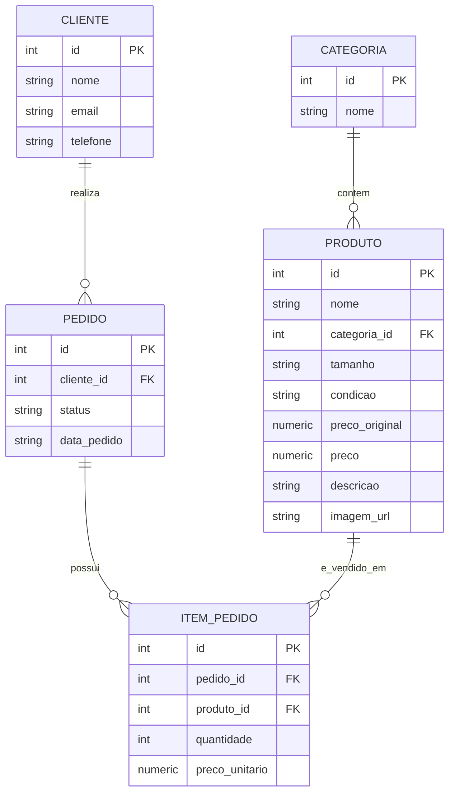

# Banco de dados — Brechó D&D

Modelagem relacional para o sistema de catálogo e pedidos do Brechó D&D, desenvolvida
para o Módulo 3 (Banco de Dados e Controle de Versão) do Projeto Integrador em
Tecnologia da Informação II.

## Modelo de dados



- **categoria → produto** (1:N): cada produto pertence a uma categoria.
- **cliente → pedido** (1:N): cada pedido pertence a um cliente.
- **pedido ↔ produto** (N:N, resolvida por `item_pedido`): um pedido pode conter vários
  produtos, e um produto pode aparecer em vários pedidos, cada ocorrência com sua
  própria quantidade e preço praticado no momento da compra.

Restrições aplicadas: chaves primárias autoincrementais, chaves estrangeiras com
`ON DELETE CASCADE` em `item_pedido` (remover um pedido remove seus itens), `UNIQUE`
em `categoria.nome`, `cliente.email` e no par `(pedido_id, produto_id)` de
`item_pedido`, e `CHECK` garantindo `preco > 0` e `preco <= preco_original`, além do
`status` do pedido restrito a um conjunto fixo de valores.

## Arquivos

- `schema.sql` — criação das tabelas, chaves e restrições (DDL).
- `seed.sql` — inserção dos produtos do catálogo, clientes e pedidos de exemplo (DML).
- `consultas.sql` — exemplos de consulta, atualização e remoção de dados.
- `run.js` — executa `schema.sql` + `seed.sql` e roda as operações de `consultas.sql`
  em um banco SQLite em memória, imprimindo o resultado de cada etapa.

## Como executar

Requer Node.js 22+ (já utilizado no projeto).

```bash
cd database
node --experimental-sqlite run.js
```

O script cria o banco do zero a cada execução, então pode ser rodado quantas vezes
forem necessárias sem efeitos colaterais.
